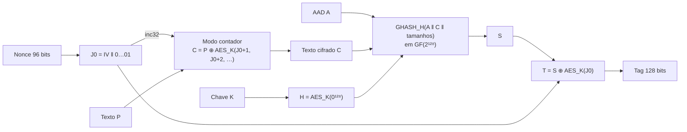

# AES-GCM: confidencialidade e integridade em uma única operação

**Disciplina:** [ENGSOFT/8] Engenharia de Segurança para Software, Uni-FACEF
**Professor:** Leandro Borges, 2º semestre de 2026
**Aluno:** _[seu nome completo]_, RA _[seu RA]_
**Trabalho:** substitutivo do Trabalho Bimestral (T1)

---

## 1. Objetivo

Explicar e demonstrar na prática como funciona o **GCM (Galois/Counter Mode)**, o modo de operação do AES usado hoje em praticamente toda comunicação segura (TLS 1.3/HTTPS, IPsec, SSH).

O trabalho tem três partes:

1. **Implementação didática** do GCM "do zero" ([`gcm/gcm_didatico.py`](gcm/gcm_didatico.py)), seguindo a especificação oficial NIST SP 800-38D e validada contra os vetores de teste oficiais e contra a biblioteca `cryptography`.
2. **Quatro demonstrações** ([`demos.py`](demos.py)) que mostram por que o GCM existe e qual é o seu ponto fraco.
3. **Uma aplicação real** ([`gcm/cofre.py`](gcm/cofre.py)): um cofre que cifra arquivos com senha usando AES-256-GCM e as boas práticas de gestão de chaves.

## 2. Ligação com o conteúdo da disciplina

| Aula | Conceito | Onde aparece neste trabalho |
|---|---|---|
| 01 | Atributos de segurança e STRIDE | O GCM combate **Tampering** (a tag detecta adulteração) e **Information Disclosure** (a cifragem garante confidencialidade) |
| 02 | Senhas, hash com salt | O cofre não usa a senha como chave: deriva a chave com **scrypt + salt** |
| 04 | Integridade, hash, HMAC | O **GHASH** faz no GCM o papel que o HMAC faz em outros protocolos: autentica a mensagem com uma chave secreta |
| 05 | AES, modos de operação, gestão de chaves | O GCM **é** um modo de operação (CTR + autenticação). A demo 3 mostra o problema do ECB e a demo 4 mostra o que acontece quando a gestão do nonce falha |

## 3. Fundamentação teórica

### 3.1 O problema: o AES sozinho só cifra 16 bytes

O AES é uma **cifra de bloco**: recebe exatamente 16 bytes (128 bits) e uma chave, e devolve 16 bytes cifrados. Para cifrar uma mensagem de qualquer tamanho é preciso um **modo de operação**, que define como os blocos são encadeados.

| Modo | Confidencialidade | Integridade | Paraleliza? | Padding? | Problema |
|---|:-:|:-:|:-:|:-:|---|
| **ECB** | fraca | não | sim | sim | Blocos iguais geram blocos cifrados iguais e **revelam padrões** (demo 3) |
| **CBC** | sim | não | só para decifrar | sim | Sequencial e vulnerável a ataques de padding oracle |
| **CTR** | sim | **não** | sim | não | **Maleável**: o atacante altera o texto sem saber a chave (demo 2) |
| **GCM** | sim | **sim** | sim | não | Exige que o nonce **nunca se repita** (demo 4) |

O GCM nasceu para resolver o problema do CTR. O CTR é rápido e seguro para esconder dados, mas não diz se eles foram alterados. Antes era preciso combinar CTR + HMAC manualmente, com duas chaves e duas passagens pelos dados, e isso era fácil de errar. O GCM junta as duas coisas em uma única operação. Esse tipo de algoritmo se chama **AEAD** (*Authenticated Encryption with Associated Data*).

### 3.2 Entradas e saídas

```
Entradas:  chave K (128/192/256 bits), nonce/IV (recomendado: 96 bits),
           texto P, dados associados A (AAD, opcionais)
Saídas:    texto cifrado C (mesmo tamanho de P) + tag T (128 bits)
```

- **Nonce (IV):** "número usado uma vez". Não precisa ser secreto, mas **nunca** pode se repetir com a mesma chave.
- **AAD:** dados que **não precisam de sigilo, mas não podem ser alterados**. Exemplos: o cabeçalho de um pacote de rede, o remetente de uma mensagem, a versão de um arquivo. Eles viajam em claro e entram no cálculo da tag.
- **Tag:** a "assinatura" de integridade. Se um único bit do texto cifrado, da AAD, do nonce ou da tag mudar, a verificação falha.

### 3.3 Funcionamento passo a passo



| Passo | Fórmula | Explicação |
|---|---|---|
| 1 | `H = AES_K(0^128)` | Cifra um bloco de zeros. O resultado `H` é a **chave de autenticação** e é secreto, porque depende de K |
| 2 | `J0 = IV ‖ 0^31 ‖ 1` | Monta o contador inicial: os 96 bits do nonce mais um contador de 32 bits começando em 1 |
| 3 | `C = GCTR_K(J0+1, P)` | **Parte "Counter":** cifra os contadores J0+1, J0+2, … e faz XOR com o texto. O AES só gera o *keystream*; o texto nunca passa por ele |
| 4 | `S = GHASH_H(A ‖ C ‖ len(A) ‖ len(C))` | **Parte "Galois":** calcula um resumo autenticado de tudo que precisa ser protegido |
| 5 | `T = S ⊕ AES_K(J0)` | Mascara o resumo com o contador J0, que não foi usado para cifrar. O resultado é a tag |

Para **decifrar**, o receptor recalcula a tag com os dados recebidos e compara com a tag enviada. **Só se forem iguais** ele decifra e libera o texto. Se não forem, nenhum byte é devolvido ([`decifrar`](gcm/gcm_didatico.py)).

### 3.4 A parte "Galois": o GHASH

O GHASH trata cada bloco de 128 bits como um **polinômio** com coeficientes 0 ou 1, ou seja, um elemento do **corpo finito de Galois GF(2¹²⁸)**. Nesse corpo:

- **Somar** é fazer **XOR** bit a bit.
- **Multiplicar** é multiplicar os polinômios e depois tirar o resto da divisão por `x¹²⁸ + x⁷ + x² + x + 1`, para o resultado continuar com 128 bits ([`gf_mult`](gcm/gcm_didatico.py)).

Com isso, o GHASH de uma sequência de blocos X₁…Xₘ é:

```
Y₀ = 0
Yᵢ = (Yᵢ₋₁ ⊕ Xᵢ) · H        →   GHASH = X₁·Hᵐ ⊕ X₂·Hᵐ⁻¹ ⊕ … ⊕ Xₘ·H
```

É a avaliação de um polinômio no ponto secreto `H`. Sem conhecer `H`, o atacante não consegue calcular o GHASH correto de uma mensagem alterada, e por isso não consegue forjar uma tag válida.

**Por que GF(2¹²⁸) e não uma soma comum?** Porque a multiplicação nesse corpo é muito barata em hardware: os processadores modernos têm instruções próprias para ela (PCLMULQDQ na Intel/AMD) e para o AES (AES-NI). É por isso que o AES-GCM é ao mesmo tempo seguro e extremamente rápido, e virou o padrão do TLS 1.3, cujo único conjunto de cifras obrigatório é `TLS_AES_128_GCM_SHA256`.

### 3.5 Regras de uso seguro

1. **Nunca repetir o par (chave, nonce).** Se repetir, o *keystream* se repete e `C1 ⊕ C2 = P1 ⊕ P2`: quem conhece uma mensagem descobre a outra (demo 4). Além disso, o atacante pode recuperar `H` e **forjar tags** para qualquer mensagem (o "forbidden attack" de Joux, 2006).
2. **Nonce de 96 bits.** É o tamanho recomendado pela NIST. Com nonces aleatórios, a NIST limita o uso a **2³² mensagens por chave**, para manter a chance de colisão desprezível.
3. **Tag de 128 bits.** Tags truncadas reduzem a segurança.
4. **Não usar o texto antes de verificar a tag**, e comparar a tag em **tempo constante** (`hmac.compare_digest`), para não vazar informação pelo tempo de resposta.
5. **Usar uma biblioteca auditada** em produção. A implementação deste trabalho é didática; o cofre usa a `AESGCM` da biblioteca `cryptography`.

## 4. Implementação

```
trabalho-aes-gcm/
├── gcm/
│   ├── gcm_didatico.py   # GCM do zero: gf_mult, ghash, gctr, cifrar, decifrar
│   └── cofre.py          # aplicação: cifrar/decifrar arquivos com senha (AES-256-GCM)
├── demos.py              # as 4 demonstrações da apresentação
├── tests/test_gcm.py     # 17 testes automatizados
└── imagens/              # imagens geradas pela demo 3
```

### 4.1 `gcm_didatico.py`

| Função | Papel |
|---|---|
| `gf_mult(x, y)` | Multiplicação em GF(2¹²⁸) (Algoritmo 1 da SP 800-38D) |
| `ghash(h, dados)` | `Yᵢ = (Yᵢ₋₁ ⊕ Xᵢ) · H` sobre blocos de 16 bytes |
| `gctr(aes, contador, dados)` | Modo contador: XOR dos dados com `AES_K(contador)`, incrementando com `inc32` |
| `cifrar(chave, iv, texto, aad)` | Passos 1 a 5; devolve `(texto_cifrado, tag)` |
| `decifrar(chave, iv, cifrado, tag, aad)` | Recalcula a tag, compara em tempo constante e só então decifra; senão lança `TagInvalida` |

Da biblioteca `cryptography` usamos **apenas** o AES de um bloco. Todo o GCM (contador, GHASH, corpo de Galois, tag) está implementado no arquivo.

### 4.2 `cofre.py`: aplicação prática

Cifra qualquer arquivo com uma senha, protegendo **dados em repouso**:

```
arquivo.cofre = "GCMCOFRE1" | salt (16 B) | nonce (12 B) | texto cifrado | tag (16 B)
                └───────────── cabeçalho = AAD ──────────┘
```

- **Chave derivada da senha com scrypt + salt aleatório.** O scrypt é um KDF lento e que usa muita memória, o que encarece a força bruta.
- **Nonce aleatório novo** a cada cifragem.
- **Cabeçalho como AAD:** a versão, o salt e o nonce viajam em claro, mas não podem ser alterados sem que a tag falhe.
- **Senha lida com `getpass`**, que não aparece na tela nem fica no histórico do terminal.
- **Não sobrescreve arquivos existentes** ao decifrar.

### 4.3 Validação

Os testes ([`tests/test_gcm.py`](tests/test_gcm.py)) comprovam que:

- a implementação reproduz **os 4 vetores de teste oficiais** do artigo do GCM (McGrew & Viega, 2004);
- ela produz **exatamente** o mesmo resultado da biblioteca `cryptography` em 200 casos aleatórios, com chaves de 128/192/256 bits, nonces de 8 a 60 bytes e textos de 0 a 99 bytes;
- a multiplicação satisfaz as propriedades de corpo (elemento neutro, comutatividade, distributividade);
- **alterar qualquer bit** do texto cifrado, a tag, a AAD, a chave ou o nonce faz a verificação falhar;
- os ataques das demos funcionam quando a regra é quebrada e falham quando é respeitada;
- o cofre recusa senha errada e arquivo adulterado.

```
Ran 17 tests in 0.065s

OK
```

## 5. Demonstrações e resultados

Os valores em hexadecimal mudam a cada execução, porque a chave e o nonce são aleatórios.

### Demo 1: cifrar e decifrar

```
Texto original:     Nota final de Engenharia de Segurança: 10  (42 bytes)
Texto cifrado:      f2 05 79 a9 bd 85 7d 8c fc 7f 47 30 ...  (42 bytes, mesmo tamanho: sem padding)
Tag (128 bits):     6d 3e 3c 3f fc 66 60 79 93 01 84 20 e3 2a 5d c2

Igual à biblioteca `cryptography`? SIM
Decifrado:          Nota final de Engenharia de Segurança: 10
```

### Demo 2: adulteração (CTR puro × GCM)

O atacante intercepta uma ordem de transferência cifrada e, **sem conhecer a chave**, faz um XOR em um único byte para trocar o "1" por "9":

```
Mensagem original:  Transferir R$ 100,00 para a conta 1234-5

[CTR sem autenticação]
  Receptor decifra:  Transferir R$ 900,00 para a conta 1234-5
  -> aceito sem nenhum aviso! O valor virou R$ 900,00.

[AES-GCM]
  Receptor recusa:   tag de autenticação inválida: os dados foram alterados
  Trocar a AAD 'origem=conta-0001' -> 'origem=conta-6666' também é recusado.
```

**Conclusão:** cifrar não é o mesmo que proteger a integridade. Esse é o ataque de **Tampering** do STRIDE, e o GCM o impede.

### Demo 3: ECB × GCM em uma imagem

Os pixels de uma imagem foram cifrados com AES nos dois modos:


```
A imagem tem 24576 blocos de 16 bytes, mas só 820 são diferentes.
```

No ECB, blocos de pixels iguais viram blocos cifrados iguais, e o desenho continua reconhecível mesmo "cifrado". No GCM, cada bloco é combinado com um contador diferente, e o resultado é indistinguível de ruído.

### Demo 4: reuso de nonce

```
Duas mensagens foram cifradas com a MESMA chave e o MESMO nonce.
O atacante conhece a primeira (é pública) e captura as duas cifradas.

Recuperado pelo atacante: Senha do servidor de provas: Lb#2026-P1-sigilo!!!!
Com nonce novo, o mesmo ataque dá só lixo: b3 36 97 70 9e 07 3e 78 dd 1a c5 2a 0a bf 98 ca ...
```

**Conclusão:** como dizia a Aula 05, "o algoritmo raramente é o elo fraco, a chave é". No GCM, o nonce faz parte desse cuidado.

## 6. Como executar

Requer Python 3.10 ou mais recente.

```bash
python -m venv .venv
.venv\Scripts\activate          # no Linux/macOS: source .venv/bin/activate
pip install -r requirements.txt

python demos.py                 # as 4 demonstrações (ou: python demos.py 2)
python -m unittest -v           # os testes

python -m gcm.cofre cifrar   meu_arquivo.pdf          # gera meu_arquivo.pdf.cofre
python -m gcm.cofre decifrar meu_arquivo.pdf.cofre    # recupera o original
```

## 7. Conclusão

O GCM resolve em uma única operação dois dos pilares estudados no bimestre:

- **Confidencialidade**, pelo modo contador sobre o AES.
- **Integridade e autenticidade**, pelo GHASH, um "hash com chave" calculado no corpo de Galois GF(2¹²⁸).

As demonstrações mostram que cifrar sem autenticar é perigoso (o valor da transferência foi alterado sem a chave) e que um modo ruim como o ECB vaza informação. Mostram também que a segurança do GCM depende inteiramente de uma regra de gestão de chaves: **nunca reutilizar o nonce**.

A implementação didática ajuda a entender o algoritmo por dentro e foi validada contra os vetores oficiais. Na prática, porém, a lição é usar uma biblioteca auditada, como faz o cofre de arquivos.

## 8. Referências

- DWORKIN, M. **NIST SP 800-38D**: Recommendation for Block Cipher Modes of Operation: Galois/Counter Mode (GCM) and GMAC. NIST, 2007.
- McGREW, D.; VIEGA, J. **The Galois/Counter Mode of Operation (GCM)**. 2004.
- **NIST FIPS 197**: Advanced Encryption Standard (AES). NIST, 2001.
- JOUX, A. **Authentication Failures in NIST version of GCM**. Comentário público à NIST, 2006.
- RESCORLA, E. **RFC 8446**: The Transport Layer Security (TLS) Protocol Version 1.3. IETF, 2018.
- STALLINGS, W. **Criptografia e Segurança de Redes: princípios e práticas**. 6. ed. São Paulo: Pearson, 2014.
